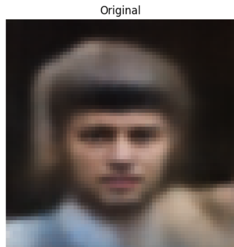
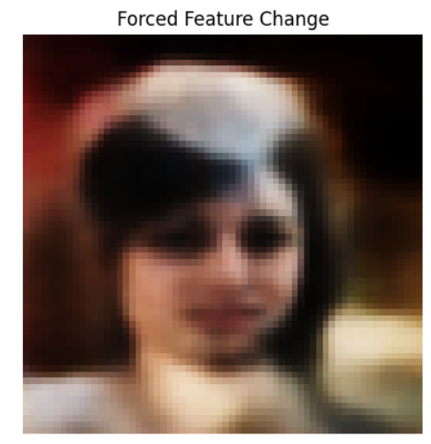

# 🎨 Celebrity Face Generation with a Variational Autoencoder (VAE)

<p align="center">
  <strong>Generate, reconstruct, and explore celebrity faces using a VAE built with PyTorch.</strong>
  <br/>
  A beginner-friendly, notebook-based deep learning project using the CelebA dataset.
</p>

<p align="center">
  
  
  
  
</p>

---

## 📌 Overview

This project implements a **Variational Autoencoder (VAE) from scratch in PyTorch** and trains it on the [CelebA celebrity-face dataset](https://www.kaggle.com/datasets/jessicali9530/celeba-dataset).

A VAE learns a compact, probabilistic representation of images in a **latent space**. The decoder can use that representation to reconstruct an input face or generate a new face from random noise.

The project explores three core capabilities:

- **Face reconstruction:** encode an image into a latent representation and reconstruct it.
- **Random generation:** sample a latent vector from a standard normal distribution and decode it into a new image.
- **Latent-space editing:** perturb selected latent dimensions and observe how the generated image changes.

> **Project status:** Experimental learning project. The current model produces low-resolution (64×64) faces, and the outputs can be blurry. The results and limitations below reflect the current 10-epoch training run.

## 🖼️ Visual Results

| Original reconstruction | Latent-space edit |
|:---:|:---:|
|  |  |
| Reconstructs an input face through the latent representation. | Shows how changing selected latent values affects the decoded image. |

## ✨ Highlights

| Capability | What it demonstrates |
|---|---|
| Convolutional encoder–decoder | Learns image features from 64×64 RGB faces |
| Probabilistic latent space | Predicts a mean and log-variance instead of a single fixed code |
| Reparameterization trick | Enables gradient-based training while sampling latent vectors |
| VAE objective | Combines reconstruction loss with KL-divergence regularization |
| Random image generation | Samples latent vectors and decodes them into images |
| Latent-space exploration | Demonstrates that latent dimensions can affect multiple visual attributes |

## 🧠 How the VAE Works

A VAE has three main steps:

1. **Encoder:** maps an input image (x) to the latent distribution parameters μ (mean) and logσ² (log-variance).
2. **Sampling:** obtains a latent vector using the reparameterization trick:
   `z = μ + exp(0.5 × logvar) × ε`, where `ε ~ N(0, I)`.
3. **Decoder:** maps `z` back to a reconstructed image `x̂`.

```text
       Input face (3 × 64 × 64)
                 │
                 ▼
       ┌───────────────────┐
       │ Convolutional     │
       │ Encoder           │
       └─────────┬─────────┘
                 ▼
          Feature vector
                 │
          ┌──────┴──────┐
          ▼             ▼
      Mean (μ)      Log variance
                         (logvar)
          └──────┬──────┘
                 ▼
       Reparameterization
        z = μ + σ ⊙ ε
                 │
                 ▼
       ┌───────────────────┐
       │ Convolutional     │
       │ Decoder           │
       └─────────┬─────────┘
                 ▼
       Reconstructed face
          (3 × 64 × 64)
```

### Model configuration

| Component | Current implementation |
|---|---|
| Input | RGB image, 64×64 pixels, values scaled to [0, 1] |
| Encoder | Three stride-2 convolution layers: 3 → 32 → 64 → 128 channels |
| Encoded feature map | 128 × 8 × 8 = 8,192 values |
| Latent space | 128-dimensional mean and log-variance vectors |
| Sampling | Reparameterization trick |
| Decoder | Linear projection followed by three transposed-convolution layers |
| Output activation | Sigmoid |
| Objective | Binary cross-entropy reconstruction loss + KL divergence |

### Loss function

The training objective combines two terms:

- **Reconstruction loss (BCE):** encourages the decoded image to resemble the input.
- **KL divergence:** regularizes the learned latent distribution toward a standard normal distribution, `N(0, I)`.

The balance between these terms helps the model learn both to reconstruct images and to organize a useful latent space.

## 📊 Training Details

The current notebooks use the CelebA dataset, resized to 64×64 pixels.

| Setting | Value |
|---|---|
| Dataset | CelebA |
| Images | 202,599 |
| Image size | 64 × 64 RGB |
| Batch size | 64 |
| Optimizer | Adam |
| Learning rate | 1e-3 |
| Training epochs | 10 |
| Reconstruction loss | Binary cross-entropy (BCE) |
| Regularization | KL divergence |

### Recorded training loss

The following values are from the current run and show the average per-image combined BCE + KL loss reported by the notebooks.

| Epoch | 1 | 2 | 3 | 5 | 10 |
|---|---:|---:|---:|---:|---:|
| Loss | 6438.50 | 6290.00 | 6269.43 | 6255.85 | 6245.04 |

The loss decreased over the run, but this alone does **not** establish image quality or prove that training has converged. Visual inspection and further evaluation are still needed.

## 📁 Repository Structure

Run the notebooks in sequence in the **same notebook session** when possible, because later notebooks reuse objects such as `train_dataloader` and `vae_model`.

| File / folder | Purpose |
|---|---|
| [`datasetdownload.ipynb`](datasetdownload.ipynb) | Downloads and extracts the CelebA dataset from Kaggle |
| [`preprocessing.ipynb`](preprocessing.ipynb) | Resizes images, converts them to tensors, and creates the DataLoader |
| [`encoderdecoder.ipynb`](encoderdecoder.ipynb) | Walkthrough of the encoder, sampling, decoder, and tensor shapes |
| [`intilization and training.ipynb`](intilization%20and%20training.ipynb) | Defines the VAE, loss function, and training loop |
| [`outputs.ipynb`](outputs.ipynb) | Produces reconstructions, random samples, and latent-space edits |
| [`results/`](results) | Images displayed in this README |

## ⚙️ Setup and Quick Start

### 1. Clone the repository

```bash
git clone https://github.com/gladiator456/Celebrity-Face-Generation-VAE.git
cd Celebrity-Face-Generation-VAE
```

### 2. Install dependencies

Use a Python environment with Jupyter Notebook or JupyterLab installed.

```bash
pip install torch torchvision matplotlib numpy kaggle jupyter
```

A CUDA-enabled PyTorch installation is recommended if you have a compatible NVIDIA GPU. Otherwise, the notebooks may run on CPU but training will generally be slower.

### 3. Configure Kaggle access

The dataset download notebook uses Kaggle access. Create an API token from your Kaggle account settings and configure the credentials **outside the notebook and outside version control**.

On Linux or macOS:

```bash
export KAGGLE_USERNAME="your-username"
export KAGGLE_KEY="your-api-key"
```

On Windows PowerShell:

```powershell
$env:KAGGLE_USERNAME="your-username"
$env:KAGGLE_KEY="your-api-key"
```

Keep your API key private. Do not paste it into a notebook that you plan to commit or share.

### 4. Run the notebooks

Open Jupyter or Google Colab and run the notebooks in this order:

1. `datasetdownload.ipynb`
2. `preprocessing.ipynb`
3. `intilization and training.ipynb`
4. `outputs.ipynb`

The `encoderdecoder.ipynb` notebook is an optional architecture walkthrough. If using separate notebook sessions, you may need to rerun earlier setup cells because variables are not automatically shared between sessions.

## 🔬 Latent-Space Editing

The current demonstration takes the encoder mean `μ` for an input face, adds **+3.5 to the first 15 latent dimensions**, and decodes the original and modified vectors.

This offset is an illustrative experiment; those dimensions were **not** identified as specific semantic controls. The resulting changes and side effects demonstrate **latent entanglement**: in a standard VAE, a single latent dimension does not necessarily correspond to one clean, human-interpretable attribute.

## ⚠️ Current Limitations

- **Blurry outputs:** pixel-wise BCE often produces smooth or blurry images.
- **Low resolution:** images are limited to 64×64 pixels.
- **Short training run:** training was limited to 10 epochs, and the recorded loss was still decreasing.
- **No saved model checkpoint:** the current workflow does not save trained weights, so reproducing outputs requires rerunning training.
- **Entangled latent dimensions:** arbitrary latent offsets can change multiple visual features at once.

## 🚀 Possible Next Steps

- Save model checkpoints and make inference possible without retraining.
- Train for more epochs and compare reconstruction quality.
- Use CelebA attribute labels to explore more meaningful latent directions, such as smiling versus not smiling.
- Experiment with a β-VAE to encourage more structured latent representations.
- Compare BCE with alternative reconstruction objectives or perceptual losses.
- Add a simple inference script or interactive demo for generating and reconstructing faces.

## 🧰 Tech Stack

- **Language:** Python
- **Deep learning:** PyTorch, Torchvision
- **Data and visualization:** NumPy, Matplotlib
- **Dataset access:** Kaggle API
- **Core concepts:** Variational Autoencoders, convolutional neural networks, reparameterization trick, KL divergence, latent-space sampling

## 📚 References

- [CelebA dataset on Kaggle](https://www.kaggle.com/datasets/jessicali9530/celeba-dataset)
- [PyTorch documentation](https://pytorch.org/docs/stable/index.html)
- [Auto-Encoding Variational Bayes — Kingma & Welling (2013)](https://arxiv.org/abs/1312.6114)

---

<p align="center">
  <em>Built to explore how generative models learn compact representations of faces.</em>
</p>
